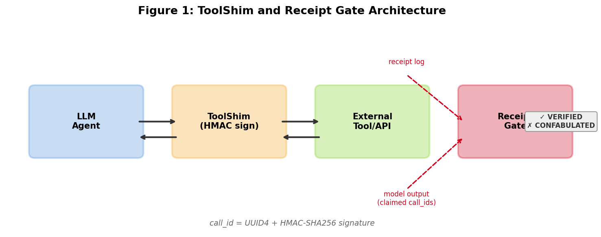
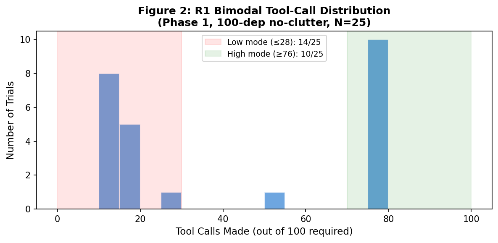
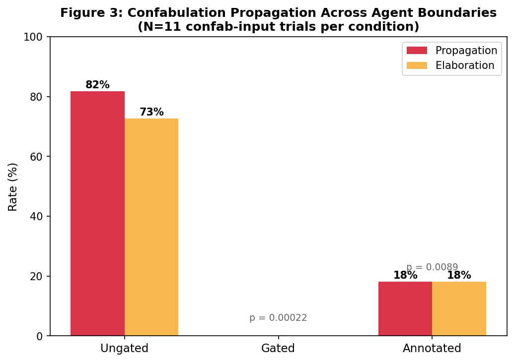
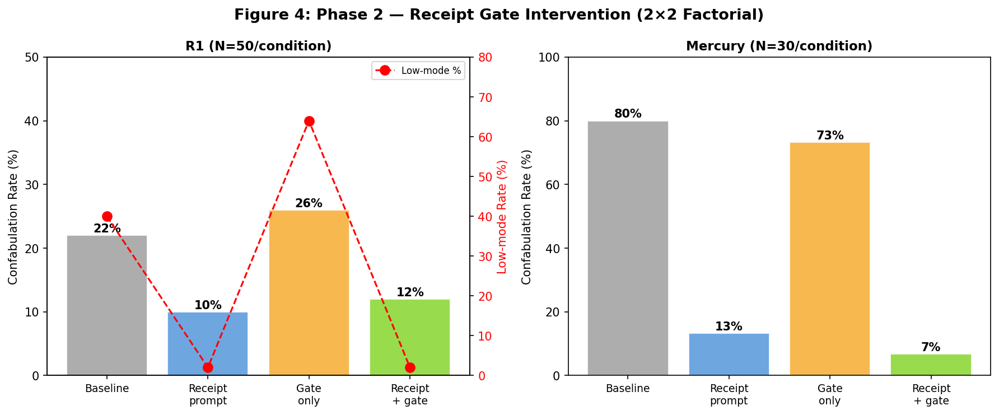

# Receipt-Gated Pipelines

**Cryptographic Verification of Tool-Call Claims in Multi-Agent LLM Systems**

Steven M. Ledbetter (Independent Researcher) — March 2026

**Read the paper:** [PDF](receipt-gated-pipelines.pdf) | [Markdown](receipt-gated-pipelines.md) | [LaTeX](receipt-gated-pipelines.tex)

## Key Finding

Large language models equipped with tools sometimes skip the tool and fabricate the result. In federated multi-agent systems, confabulated output crosses agent boundaries and gets elaborated — downstream agents invent CVE numbers, patch versions, and remediation priorities for vulnerabilities that were never checked. A deterministic receipt gate blocks this completely.

| | Ungated | Gated | p-value |
|---|---|---|---|
| Propagation rate | **82%** (9/11) | **0%** (0/11) | 0.00022 |
| Elaboration rate | **73%** (8/11) | **0%** (0/11) | 0.00022 |
| Mercury confab (baseline → receipt) | **80%** → **13%** | | < 0.0000004 |
| R1 low-mode collapse (baseline → receipt) | **40%** → **2%** | | 0.0000024 |
| Total study cost | | | **$15.42** |

## Results at a Glance


*Figure 1: ToolShim and Receipt Gate Architecture. The ToolShim signs every tool call with an HMAC-SHA256 receipt. The gate verifies claimed call_ids against the receipt log — zero false negatives by construction.*


*Figure 2: R1 bimodal tool-call distribution. 40% of baseline trials cluster in a low mode (10–28 calls out of 100 required). The receipt prompt collapses this to 2%.*


*Figure 3: Confabulation propagation across agent boundaries. 82% of ungated confab-input trials propagate; the receipt gate blocks all propagation.*


*Figure 4: Phase 2 receipt gate intervention. Left: R1 (N=50/condition). Right: Mercury (N=30/condition). Red dots show low-mode rate for R1.*

## Study Design

- **686 production trials** across 4 experimental phases
- **9 models:** DeepSeek R1, DeepSeek V3, Mercury 2, Gemini 2.0 Flash, Claude Haiku 4.5, Claude Sonnet 4.6, GPT-4o Mini, Llama 3.1 70B, Mistral Small (excluded)
- **Task:** Audit software dependencies for known vulnerabilities using the OSV.dev API
- **Total cost:** $15.42 | **Runtime:** ~9 hours | **Single session:** March 14, 2026

| Phase | Design | Trials | Finding |
|---|---|---|---|
| Phase 1 | Baseline measurement, 8 models | 196 | 3/8 models confabulate at 25–50%; two distinct patterns |
| Phase 2 | 2×2 factorial (prompt × gate), R1 + Mercury | 320 | Gate detects all confabulation; prompt reduces it model-dependently |
| Phase 3 | Two-rig federation (R1 → Flash), 3 conditions | 90 | 82% propagation ungated; 0% gated; 18% annotated |
| Phase 4 | 2×2 factorial (echo × disclosure), R1 + Mercury | 80 | Both components independently collapse R1's bimodal distribution |

## Five Contributions

1. **Silent-skip confabulation measured.** 3 of 8 models skip tool calls and fabricate results at 25–50% rates — mixing real and fake data in the same report.
2. **Two confabulation patterns identified.** Partial-completion (R1/V3: start calling, stop early, fill in the rest) and full-skip (Mercury: check ~10 packages, claim results for 30).
3. **Receipt gate provides zero-false-negative detection.** HMAC-signed receipts make confabulation deterministically detectable. The gate catches every fabricated claim.
4. **Confabulation propagates and elaborates in federation.** 82% propagation rate; downstream agents add authority to fabricated findings. The gate blocks this completely.
5. **Structured output sustains effort.** Any format that makes gaps visible reduces confabulation — the mechanism is visibility, not accountability.

## For Gas Town / Wasteland Developers

The propagation finding is directly relevant to [Gas Town](https://steve-yegge.medium.com/welcome-to-gas-town-4f25ee16dd04) and the [Wasteland](https://steve-yegge.medium.com/welcome-to-the-wasteland-a-thousand-gas-towns-a5eb9bc8dc1f). When completions cross rig boundaries, confabulated tool results propagate and get elaborated. The receipt gate integrates naturally with the stamp-based trust system — a rig that submits verified completions builds trust; one that submits confabulated claims loses it.

The ToolShim and gate implementations are in [`scripts/phase2.py`](scripts/phase2.py). The receipt prompt texts are in Appendix G of the paper.

## Repository Structure

```
├── receipt-gated-pipelines.pdf  # Paper (27 pages)
├── receipt-gated-pipelines.md   # Paper (Markdown)
├── receipt-gated-pipelines.tex  # Paper (LaTeX source)
├── data/
│   ├── deps_30.json             # 30-dependency test list
│   ├── deps_100.json            # 100-dependency test list
│   ├── phase1/                  # 11 JSONL files, 197 trials across 9 models
│   ├── phase2/                  # 13 JSONL files (raw + corrected), 320 trials
│   ├── phase3/                  # 2 JSONL files (raw + corrected), 90 trials
│   └── phase4/                  # 2 JSONL files, 80 trials
├── scripts/
│   ├── phase1.py                # Phase 1 experiment runner
│   ├── phase1_multimodel.py     # Multi-model Phase 1 variant
│   ├── analyze_phase1.py        # Phase 1 analysis
│   ├── phase2.py                # Phase 2 runner (ToolShim, receipt gate, 2×2 factorial)
│   ├── phase3.py                # Phase 3 two-rig propagation experiment
│   ├── phase4.py                # Phase 4 disentanglement experiment
│   ├── reanalyze_phase2.py      # Measurement correction (Bug 1 + Bug 2)
│   └── reanalyze_phase3.py      # Phase 3 Rig A reclassification
├── figures/                     # 4 figures (PNG)
└── README.md
```

## Verifying Claims

All results can be verified from the included JSONL data without re-running experiments.

```python
# Verify Table 2: R1 Phase 2 confabulation rates
import json
trials = []
for f in ['data/phase2/phase2_20260314_061615_corrected.jsonl',
          'data/phase2/phase2_deepseek-r1_20260314_080559_corrected.jsonl']:
    with open(f) as fh:
        for line in fh:
            trials.append(json.loads(line))
for cond in ['baseline', 'receipt_prompt', 'gate_only', 'receipt_gate']:
    s = [t for t in trials if t['condition_key'] == cond]
    confab = sum(1 for t in s if t['confab_corrected_count'] > 0)
    print(f"{cond}: {confab}/{len(s)} = {confab/len(s)*100:.1f}%")
# baseline: 11/50 = 22.0%
# receipt_prompt: 5/50 = 10.0%
# gate_only: 13/50 = 26.0%
# receipt_gate: 6/50 = 12.0%
```

```python
# Verify Table 4: Phase 3 propagation rates
with open('data/phase3/phase3_gemini-flash_20260314_103603_corrected.jsonl') as fh:
    trials = [json.loads(line) for line in fh]
for cond in ['ungated', 'gated', 'annotated']:
    ci = [t for t in trials if t['condition_key'] == cond and t['is_confab_input_corrected']]
    prop = sum(1 for t in ci if t['propagation_count'] > 0)
    print(f"{cond}: {prop}/{len(ci)} propagation")
# ungated: 9/11, gated: 0/11, annotated: 2/11
```

```python
# Recompute Fisher exact tests
from scipy.stats import fisher_exact
print(f"Gate vs ungated: p = {fisher_exact([[9,2],[0,11]])[1]:.6f}")      # 0.000221
print(f"Mercury receipt: p = {fisher_exact([[24,6],[4,26]])[1]:.8f}")      # 0.00000033
print(f"R1 bimodal:      p = {fisher_exact([[20,30],[1,49]])[1]:.8f}")     # 0.00000237
```

## Key Limitations

- **Single task domain.** Vulnerability checking has unusually high parametric knowledge temptation. Other tool-use tasks may produce different rates.
- **Two confabulating models tested.** R1 and Mercury received full factorial treatment; V3 (45% confab) was not.
- **R1 baseline instability.** Confabulation rate dropped from 60% to 22% under identical conditions three hours apart (p = 0.002). The within-phase receipt comparison (22%→10%) is not significant (p = 0.17).
- **Progressive design.** Each phase was designed after the previous phase's results. Later phases are exploratory, not confirmatory.
- **Phase 3 format confound.** Ungated = free text, gated = structured report. Format alone could affect downstream behavior.

See Section 6 of the paper for the full limitations accounting (9 subsections).

## Measurement Corrections

Two bugs were found and fixed during analysis. Correction scripts and both raw and corrected data are included:

1. **Bug 1 (substring matching):** `"ini"` matching inside `"iniconfig"` inflated R1 confabulation. Fixed with word-boundary regex. Script: [`reanalyze_phase2.py`](scripts/reanalyze_phase2.py)
2. **Bug 2 (unverified field):** Mercury's honest disclosures counted as confabulation. Fixed by excluding self-reported packages. Script: [`reanalyze_phase2.py`](scripts/reanalyze_phase2.py)
3. **Rig A reclassification:** 3 Phase 3 trials had only substring false positives as "confab" packages. Reclassified as clean input. Script: [`reanalyze_phase3.py`](scripts/reanalyze_phase3.py)

## Related Work

Companion studies:

- [**Structure Beats Scale**](https://github.com/smledbetter/structure-beats-scale) — Structured review pipelines outperform brute-force generation in code synthesis. Convergent finding: structure > scale for inference-time compute allocation.
- [**Single-Round Debate Degrades Reasoning**](https://github.com/smledbetter/debate-degrades-reasoning) — Adversarial debate hurts symmetric reasoning; complementary coverage preserves it. Convergent finding: cooperative architectures outperform adversarial ones.

## Citation

```
Ledbetter, S. M. (2026). Receipt-Gated Pipelines: Cryptographic Verification of
Tool-Call Claims in Multi-Agent LLM Systems.
GitHub: https://github.com/smledbetter/receipt-gated-pipelines.
```

## License

MIT
